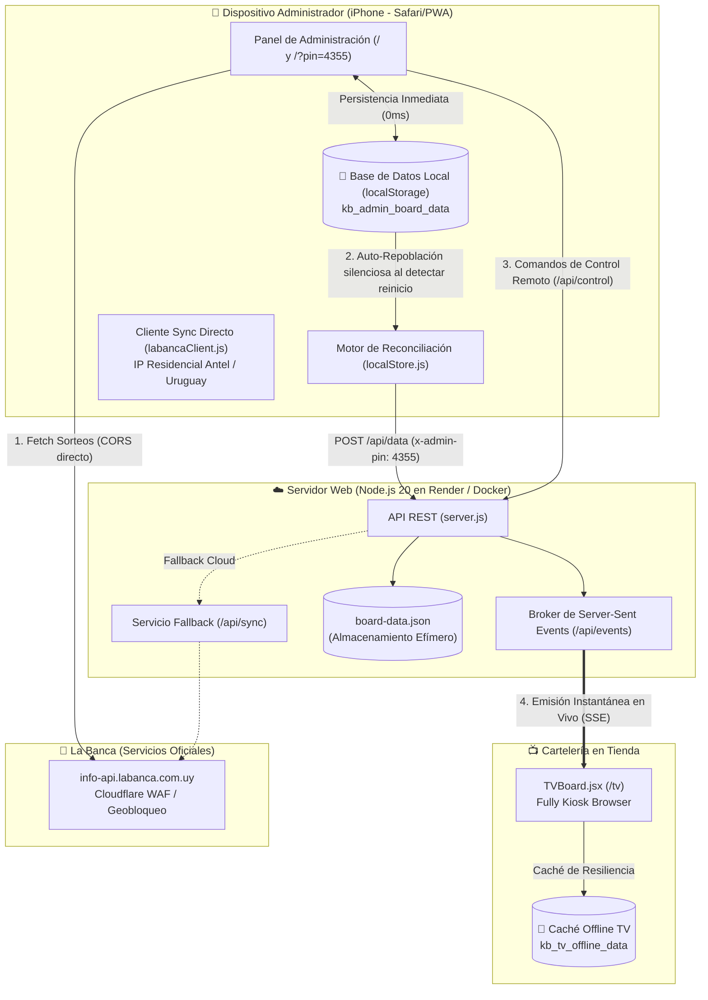

# GEMINI.md - Contexto Integral del Sistema (SDD Ready)
## Remote Board 📺🎰 | Kiosko Belvedere
> **Propósito:** Documento de contexto técnico y funcional exhaustivo para Spec-Driven Development (SDD), diseño de software y orquestación asistida por IA.

---

## 1. Visión General del Producto y Dominio de Negocio

### 1.1. Contexto Operativo
* **Comercio:** *Kiosko Belvedere* (comercio de conveniencia, minimercado y sub-agencia oficial de loterías en Montevideo, Uruguay).
* **Usuario Administrador:** Juan Manuel Amatrain (propietario del comercio, opera desde su teléfono móvil iPhone conectado a red móvil local uruguaya de Antel).
* **Propósito del Sistema:** Cartelería digital (*digital signage*) 100% autónoma proyectada en el salón de ventas mediante un televisor **Spica LED de 32"** conectado por HDMI a una **Android TV Box (MXQ Pro 4K 5G)**.
* **Contenido Emitido:**
  1. Resultados oficiales de sorteos de **La Banca** (Quiniela Vespertina/Nocturna, Tómbola Vespertina/Nocturna, 5 de Oro Sorteo con bolillas doradas 3D y pozos acumulados estimados).
  2. Carteles dinámicos de ofertas y promociones comerciales del kiosko (bebidas, cigarrillos, accesorios, combos relámpago).
* **URL de Producción:** `https://kiosko-belvedere.onrender.com`
  * `/tv`: Modo visualización para el televisor (sin controles, pantalla completa, auto-rotación y SSE).
  * `/` o `/?pin=4355`: Panel de control móvil administrativo protegido por PIN maestro.

---

## 2. Arquitectura de Hardware y Despliegue Kiosk

```
[Red Eléctrica Kiosko] 
         │
         ▼
[Android TV Box: MXQ Pro 4K 5G] ──── HDMI ────▶ [TV Spica LED 32"]
   │ (Auto-boot al encender)
   ▼
[Fully Kiosk Browser (Fully Factory GmbH)]
   │ • Start URL: https://kiosko-belvedere.onrender.com/tv
   │ • Modo Kiosk: Fullscreen sin barras de Android
   │ • Keep Screen On: Sin reposo ni apagado de display
   │ • Auto-reconnect: Reintenta ante demoras del Wi-Fi
   ▼
[Render Cloud Service (Docker linux/amd64)]
```

---

## 3. Arquitectura del Software



---

## 4. Persistencia Híbrida: Local-First & Auto-Repoblación en Render

### 4.1. El Desafío del Almacenamiento Efímero
En los planes gratuitos de Render, el contenedor entra en modo *spin-down* por inactividad y sus archivos locales se restablecen al estado original empaquetado en la imagen Docker (`/app/data/board-data.json`).

### 4.2. La Solución Local-First (`src/utils/localStore.js`)
* **Fuente Primaria de Verdad:** El almacenamiento local (`localStorage`) del teléfono del único administrador (Juan).
* **Reconciliación Inteligente (`reconcileData`):**
  1. Al abrir el Panel de Control, los datos locales se leen en **0 ms**.
  2. Se consulta el servidor con `GET /api/data`.
  3. Si el servidor fue reiniciado (su `updatedAt` es más antiguo que `_localSavedAt`), la aplicación ejecuta de fondo un `POST /api/data` restaurando inmediatamente todas las promociones, estados pausados, tiempos de rotación y paletas al servidor y al televisor.
  4. Si el servidor contiene sorteos más recientes obtenidos por la noche, los fusiona hacia la base local.
* **Copias de Seguridad Físicas:** Exportación e importación de archivos `.json` descargables desde la interfaz de Ajustes del TV.

---

## 5. Esquema de Datos Canónico (`board-data.json`)

```typescript
interface BoardData {
  pinHash: string;                  // SHA-256 del PIN maestro (4355)
  isPaused: boolean;                // Estado de pausa de rotación remota
  updatedAt: string;                // ISO 8601 de última actualización
  _localSavedAt?: string;           // Timestamp local en el dispositivo admin
  rotationSeconds: number;          // Segundos por diapositiva (default: 60)
  activeScreens: {
    quinielaVespertina: boolean;
    tombolaVespertina: boolean;
    quinielaNocturna: boolean;
    tombolaNocturna: boolean;
    cincoDeOroSorteo: boolean;     // Sorteo oficial (bolillas doradas)
    cincoDeOro: boolean;           // Pozos estimados acumulados
  };
  fechaGeneral: string;             // DD/MM/AA
  quinielaVespertina: LotteryGame;
  tombolaVespertina: LotteryGame;
  quinielaNocturna: LotteryGame;
  tombolaNocturna: LotteryGame;
  cincoDeOro: CincoDeOroData;
  promociones: PromoSlide[];
}

interface LotteryGame {
  fecha: string;                    // DD/MM/AA o AAAA-MM-DD
  numeros: string[];                // 20 posiciones (cifras de 2 o 3 dígitos)
}

interface CincoDeOroData {
  fecha: string;                    // Fecha del sorteo (ej: "18/11/26")
  numerosOro: string[];             // 5 bolillas (ej: ["16", "21", "26", "41", "42"])
  bolillaExtra: string;             // Bolilla extra (ej: "19")
  numerosRevancha: string[];        // 5 bolillas revancha (ej: ["03", "06", "33", "35", "39"])
  aciertosOro: number;              // 0 = Vacante
  aciertosPlata: number;
  aciertosRevancha: number;         // 0 = Vacante
  pozoOro: string;                  // Monto formateado (ej: "$ 16.500.000")
  pozoRevancha: string;             // Monto formateado (ej: "$ 5.500.000")
  proximoSorteo: string;            // Texto informativo (ej: "Lunes 23")
  tema: 'blue' | 'gold' | 'purple' | 'emerald' | 'ruby' | 'dark';
}

interface PromoSlide {
  id: string;                       // Identificador único (ej: "promo-1795184859182")
  active: boolean;                  // Si se incluye en la rotación del TV
  tag: string;                      // Distintivo superior (ej: "OFERTA", "SUPER PROMO")
  titulo: string;                   // Título grande del producto
  subtitulo: string;                // Descripción o detalle
  precio: string;                   // Precio formateado (ej: "$ 75")
  nota: string;                     // Pie o condiciones (ej: "Hasta agotar stock")
  tema: 'orange' | 'yellow' | 'red' | 'purple' | 'blue' | 'emerald';
  modelo?: 'clasico' | 'inclinado' | 'columnas';
}
```

---

## 6. Endpoints de la API REST y Broker SSE (`server.js`)

| Método | Endpoint | Cabeceras Requeridas | Descripción |
| :--- | :--- | :--- | :--- |
| `GET` | `/api/data` | Ninguna | Devuelve el estado actual de la cartelería (`board-data.json`). |
| `POST` | `/api/data` | `x-admin-pin: <PIN>` | Actualiza los datos, los persiste en disco y los emite en vivo a todos los clientes SSE conectados. |
| `GET` | `/api/events` | Ninguna | Canal SSE persistente (*keep-alive* cada 25s) para recepción en tiempo real en `/tv`. |
| `POST` | `/api/control` | `x-admin-pin: <PIN>` | Envía comandos remotos al televisor (`next`, `prev`, `pause`, `resume`, `goto`, `reload`). |
| `POST` | `/api/verify-pin`| Ninguna | Valida el PIN contra el hash SHA-256. |
| `POST` | `/api/change-pin`| `x-admin-pin: <PIN>` | Actualiza el PIN maestro en el servidor. |
| `POST` | `/api/sync` | `x-admin-pin: <PIN>` | Endpoint fallback de consulta al backend contra la API de La Banca. |

---

## 7. Módulo de Sorteos Oficiales y Lógica de La Banca

### 7.1. Identificadores de Juegos en la API Oficial
* **Quiniela (Juego 1):** `https://info-api.labanca.com.uy/info-api/v1/game/result/1/last/1`
* **Tómbola (Juego 3):** `https://info-api.labanca.com.uy/info-api/v1/game/result/3/last/1`
* **5 de Oro (Juego 5):** `https://info-api.labanca.com.uy/info-api/v1/game/result/5/last/1`
  * Días oficiales de sorteo: **Miércoles y Domingos** (horario habitual: 22:00 hs).

### 7.2. Extracción de Bolillas del 5 de Oro
La API devuelve una estructura con:
* `draw.balls` (5 bolillas de Oro en posiciones 0-4 + 1 Bolilla Extra en posición 5).
* `draw.revanchaBalls` (5 bolillas del Pozo Revancha en posiciones 0-4).
* `draw.jackpots` (Pozos estimados en pesos uruguayos).
* `draw.winners` (Cantidad de aciertos para determinar si el pozo quedó vacante).

---

## 8. Mando a Distancia Virtual y Control en Tiempo Real

Desde el celular, el comerciante cuenta con botones de acción inmediata que emiten comandos por el broker SSE al televisor:
* **`reload`:** Fuerza un `window.location.reload()` en el navegador del televisor.
* **`pause` / `resume`:** Congela o reanuda la rotación para mantener un sorteo fijo en pantalla a pedido de un cliente en el local.
* **`goto`:** Salto directo con un tap al slide deseado (Quiniela Vesp, Tómbola Vesp, Quiniela Noct, Tómbola Noct, 5 de Oro Sorteo, 5 de Oro Pozos, Ofertas).
* **`rotationSeconds`:** Selector de tiempos rápidos (`10s`, `15s`, `20s`, `30s`, `45s`, `60s`).

---

## 9. Convenciones de Código y Estilos

1. **Framework:** React 18 con Vite y Tailwind CSS v3.
2. **Íconos:** `lucide-react`.
3. **Bolillas 3D:**
   * `.lottery-ball`: Bolilla celeste de Tómbola con sombreado esférico radial y número negro centrado.
   * `.lottery-ball-gold`: Bolilla dorada de 5 de Oro (`background: radial-gradient(circle at 35% 30%, #fff7a1 0%, #facc15 35%, #ca8a04 70%, #713f12 100%)`).
   * `.lottery-ball-gold-extra`: Bolilla extra de 5 de Oro en tonos ámbar y fuego con insignia flotante `EXTRA` fija sin desalinear la horizontal.
4. **Legibilidad para TV:**
   * Contraste extremo pensado para paneles LED Spica a distancias de 3 a 7 metros.
   * Tipografías: `Oswald`, `Montserrat` y `font-mono` con grosores `font-black` (900).
   * Prohibido texto oscuro sobre fondos oscuros; los banners deben contar con fondos luminosos, marcos coloreados (`border-2 border-yellow-400`) y sombras de texto de alta definición.

---

## 10. Guía Rápida para Tareas de SDD (Spec-Driven Development)

Cuando se formulen nuevas especificaciones o funcionalidades para este sistema:
1. **Mantener compatibilidad con la persistencia local:** Cualquier campo nuevo agregado a `BoardData` debe ser considerado en `reconcileData()` de [src/utils/localStore.js](file:///Users/juan/Documents/sistemas/remote-board/src/utils/localStore.js).
2. **Preservar el aislamiento de eventos de React:** Nunca pasar referencias directas `onClick={handleSave}`; usar siempre funciones envolventes `onClick={() => handleSave()}` para evitar errores de serialización de estructuras cíclicas.
3. **Asegurar compatibilidad con el navegador Kiosk del TV:** No emplear APIs experimentales no soportadas por Android System WebView Chromium en cajas Android 9/10/11.
4. **Respetar la política de autoría del local:** Todo texto legal o visible debe identificar a **"Kiosko Belvedere"** como software informativo del comercio, sin atribuir la propiedad del software a entidades estatales o terceros.

---
*Documento canónico de especificación y contexto para Kiosko Belvedere Remote Board.*
