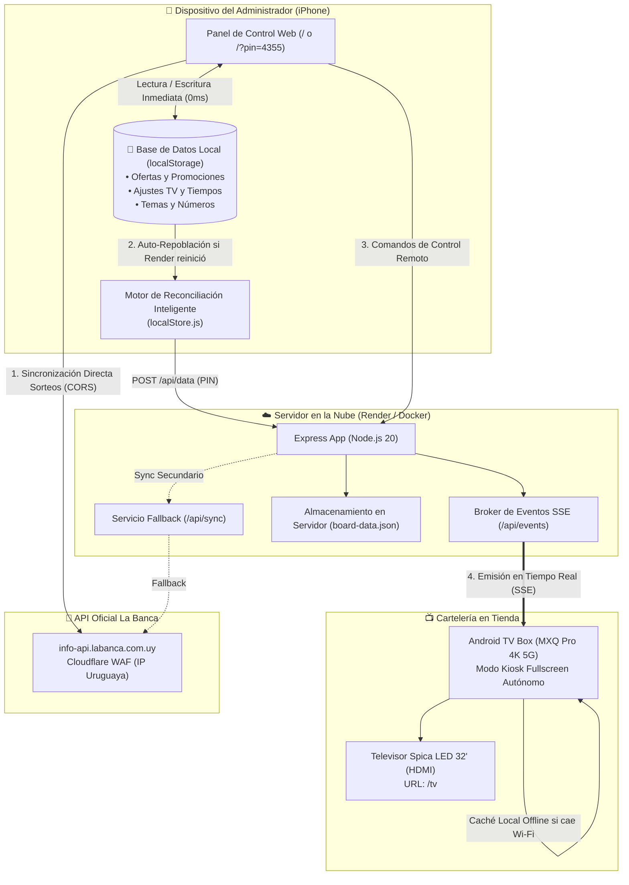
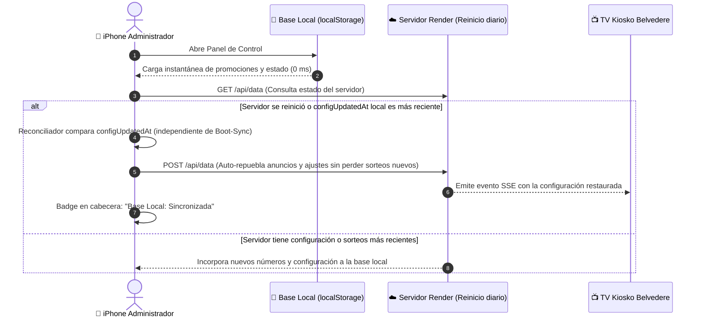
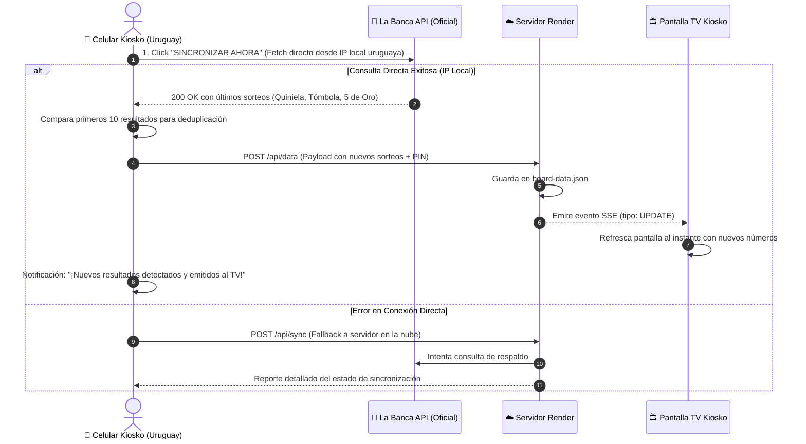
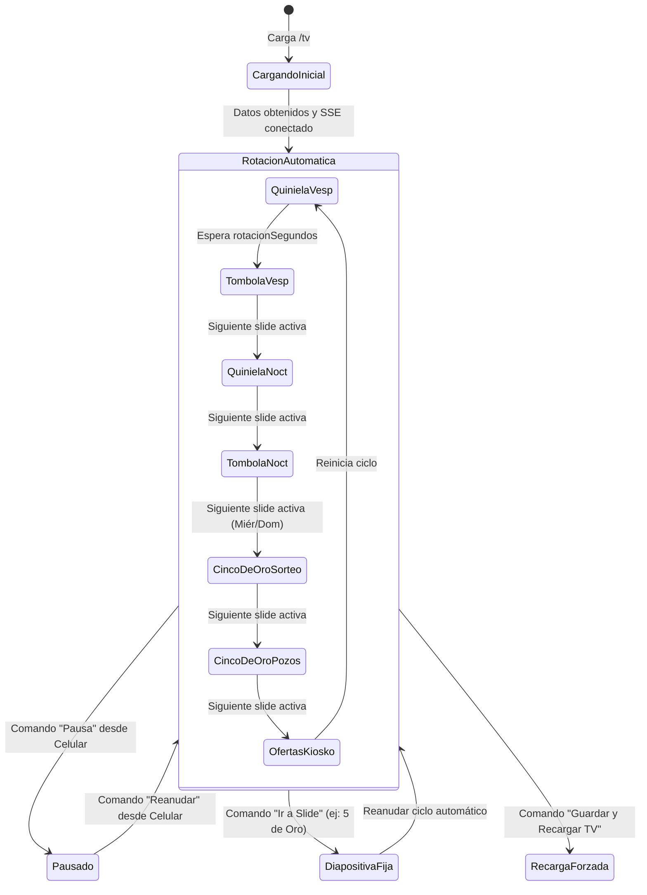

# Remote Board 📺🎰 | Kiosko Belvedere
### Sistema Integral de Cartelería Digital & Control Remoto en Tiempo Real

[](https://nodejs.org/)
[](https://react.dev/)
[](https://vitejs.dev/)
[](https://tailwindcss.com/)
[](https://www.docker.com/)
[](https://kiosko-belvedere.onrender.com)

**Remote Board** es una plataforma completa de cartelería digital para puntos de venta y agencias de lotería uruguayas, diseñada a medida para el comercio **Kiosko Belvedere**. 

El sistema proyecta en un televisor **Spica LED de 32"** conectado por HDMI a una **Android TV Box (MXQ Pro 4K 5G)** los resultados oficiales de la **Quiniela**, **Tómbola** y **5 de Oro** con sincronización en vivo mediante la API de **La Banca**, alternando con pantallas dinámicas de ofertas y promociones del kiosko. Se administra y controla en tiempo real desde el dispositivo móvil (iPhone / Android) vía **Server-Sent Events (SSE)** con persistencia local en el dispositivo del comercio.

---

## 🏗️ 1. Arquitectura del Sistema



---

## 💾 2. Base de Datos Local & Auto-Repoblación en Render

En los planes gratuitos de Render, el contenedor entra en modo de reposo (*spin-down*) y el almacenamiento en disco es efímero (se restablece al estado original de la imagen Docker en cada reinicio).

Para garantizar que **nunca se pierdan las promociones creadas, las ofertas pausadas, los segundos de rotación ni los ajustes del TV**, el sistema utiliza una arquitectura de **Persistencia Primaria en el Dispositivo**:



### Características de la Base de Datos Local:
1. **Persistencia Total:** Todas las modificaciones (nuevas ofertas, pausas de productos, cambios de tema del 5 de Oro, ajustes de zoom) se guardan primero en la memoria local del teléfono (`localStorage`) con su propio timestamp de configuración (`configUpdatedAt`).
2. **Auto-Repoblación Silenciosa (aislada de `Boot-Sync`):** Si el contenedor de Render se reinicia al desplegar una nueva versión o tras un *spin-down* y ejecuta `Boot-Sync`/`Auto-Sync` de La Banca, `updatedAt` cambia solo para los sorteos mientras `configUpdatedAt` protege las promociones y ajustes del comercio para restaurarlos sin sobrescrituras.
3. **Copias de Seguridad (Exportar / Importar JSON):** En la pestaña **Ajustes TV**, el comerciante cuenta con botones para descargar un archivo `.json` de respaldo y restaurarlo en cualquier momento o dispositivo.

---

## ⚡ 3. Sincronización Oficial de Sorteos (La Banca)

El sistema consulta directamente los sorteos oficiales de **La Banca** evitando los bloqueos de Cloudflare gracias a la IP uruguaya del celular:



---

## 📺 4. Inicio Automático y Pantalla Completa en Android Box (MXQ Pro 4K 5G)

Para evitar usar el control remoto físico cada día al encender el kiosko, se configura la Android TV Box para que **arranque automáticamente en pantalla completa (Modo Kiosk)** sin barras de navegación ni menús.

### Solución Recomendada: Fully Kiosk Browser (Estándar de Cartelería Digital)

**Fully Kiosk Browser** es la aplicación líder para señalización digital en Android:
1. **Descarga en la TV Box:**
   - Abrir el navegador en la TV Box e ingresar a: `https://www.fully-kiosk.com/#download-box` (o buscar *Fully Kiosk Browser* en Google Play / Aptoide TV).
2. **Configuración inicial (se hace una sola vez):**
   - **Start URL:** `https://kiosko-belvedere.onrender.com/tv`
   - **Start on Boot:** Activar `ON` (inicia automáticamente al conectar la corriente).
   - **Kiosk Mode (Full Screen):** Activar `ON` (elimina la barra de estado y la barra de navegación de Android).
   - **Keep Screen On:** Activar `ON` (evita que la pantalla se apague o entre en suspensión).
   - **Autoreload on Network Reconnect:** Activar `ON` (recarga la página automáticamente si el Wi-Fi se reconecta).
3. **Resultado:** Al encender la zapatilla o el enchufe del kiosko por la mañana, la Android TV Box arranca y en 15 segundos queda proyectando la cartelería en pantalla completa sin tocar ningún control remoto.

### Alternativa Gratuita (Play Store): AutoStart + TV Bro
1. Instalar la app gratuita **AutoStart - No root** desde Google Play Store.
2. Añadir como aplicación de inicio el navegador **TV Bro**.
3. En **TV Bro**: configurar la página de inicio en `https://kiosko-belvedere.onrender.com/tv` y activar en sus ajustes *"Ocultar barras / Pantalla completa"*.

---

## 🎨 5. Pantallas y Sorteos



### Detalle de Pantallas:
1. **Quiniela (Vespertina & Nocturna):**
   - Fondo verde césped oficial. 20 casilleros tabulares (1º al 20º premio) con alta legibilidad a más de 5 metros.
2. **Tómbola (Vespertina & Nocturna):**
   - Fondo rojo carmesí oficial. 20 bolillas celestes con sombreado esférico 3D ordenadas numéricamente de menor a mayor.
3. **5 de Oro (Resultados Oficiales del Sorteo):**
   - Fondo en **tonalidades azules profundas** y barra lateral izquierda con logo oficial, fecha y día del sorteo (Miércoles y Domingos).
   - **Bolillas Doradas 3D con letras negras**: 5 bolillas de Pozo de Oro + Bolilla Extra en ámbar con insignia flotante + 5 bolillas de Pozo Revancha.
   - Estado de vacante o ganadores para Pozo de Oro y Revancha.
   - Banner inferior de alto contraste con los pozos estimados para el próximo sorteo.
4. **5 de Oro (Pozos Acumulados):**
   - Montos destacados en tipografía gigante para el Pozo de Oro y Pozo Revancha.
   - Selector de temas en vivo (Azul Oficial, Violeta Premium, Dorado/Negro, Rojo Ruleta, Verde Esmeralda).
5. **Ofertas y Promociones (Kiosko Belvedere):**
   - Módulo para destacar productos del comercio (refrescos, golosinas, combos, cigarrillos).
   - Modelos visuales: Estándar, Inclinado Relámpago (`/ \`) y 2 Columnas.
   - Botón de pausa/reactivación instantánea de ofertas.

---

## 🔐 6. Seguridad y Control Remoto

* **PIN Maestro Permanente:** `4355`.
* **Protección de API:** Las peticiones `POST` a `/api/data`, `/api/control`, `/api/sync` y `/api/change-pin` requieren la cabecera `x-admin-pin`.
* **Mando Virtual en Vivo:**
  - Control de tiempo por slide (`10s`, `15s`, `20s`, `30s`, `45s`, `60s`).
  - Botones de salto directo para forzar un sorteo en pantalla.
  - Pausar / Reanudar rotación.
  - Botón *"Guardar y Recargar TV"* para refrescar el navegador del televisor a distancia.

---

## 📁 7. Estructura del Proyecto

```
remote-board/
├── data/
│   └── board-data.json               # Almacenamiento JSON en servidor con estado y PIN
├── src/
│   ├── components/
│   │   ├── AdminPanel.jsx            # Panel de administración, mando virtual y gestión
│   │   ├── TVBoard.jsx               # Pantalla de visualización para el TV con SSE
│   │   ├── slides/
│   │   │   ├── QuinielaSlide.jsx     # Diapositiva oficial de Quiniela
│   │   │   ├── TombolaSlide.jsx      # Diapositiva oficial de Tómbola (bolillas 3D)
│   │   │   ├── CincoDeOroSorteoSlide.jsx # Sorteo 5 de Oro (bolillas doradas, azul oficial)
│   │   │   ├── CincoDeOroSlide.jsx   # Pozos acumulados del 5 de Oro con temas
│   │   │   └── KioskoSlide.jsx       # Diapositiva de ofertas y combos
│   │   └── common/
│   │       └── Logos.jsx             # Logos vectoriales (Quiniela, Tómbola, 5 de Oro)
│   ├── services/
│   │   └── labanca.js                # Servicio de consulta backend a La Banca
│   ├── utils/
│   │   ├── localStore.js             # Base de datos local, persistencia y respaldos JSON
│   │   └── labancaClient.js          # Cliente de sincronización directa (CORS / IP uruguaya)
│   ├── App.jsx                       # Enrutador principal (/ y /tv)
│   ├── index.css                     # Estilos globales y efectos 3D de bolillas
│   └── main.jsx                      # Punto de entrada de React
├── server.js                         # Servidor Express, API REST y Broker SSE
├── Dockerfile                        # Imagen Docker multiarquitectura (linux/amd64)
├── GEMINI.md                         # Especificación y contexto integral para SDD
└── package.json                      # Dependencias y scripts de construcción
```

---

## 📐 8. Especificación de Diseño y SDD (Spec-Driven Development)
El documento canónico para análisis, evolución y desarrollo dirigido por especificaciones (SDD) se encuentra en [GEMINI.md](file:///Users/juan/Documents/sistemas/remote-board/GEMINI.md). Contiene los contratos de datos de TypeScript, endpoints de la API, ciclo de vida de reconciliación local-first y directrices de diseño.

---
*Desarrollado para **Kiosko Belvedere** | Sistema de Cartelería Digital Oficial.*
