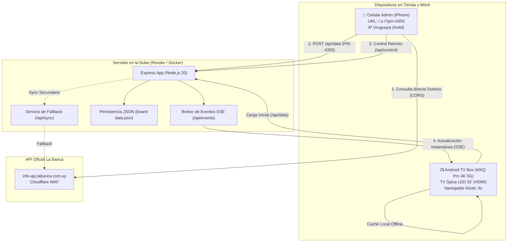
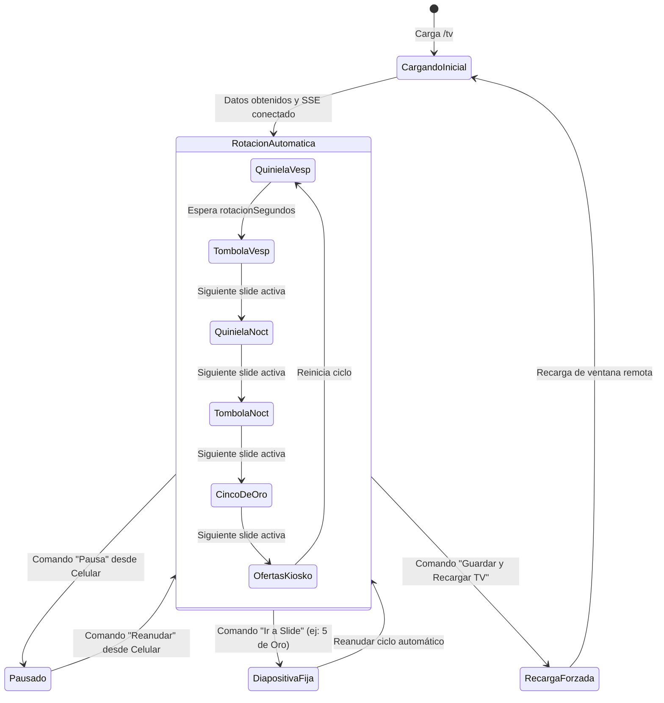

# Remote Board 📺🎰 | Kiosko Belvedere
### Sistema Integral de Cartelería Digital & Control Remoto en Tiempo Real

[](https://nodejs.org/)
[](https://react.dev/)
[](https://vitejs.dev/)
[](https://tailwindcss.com/)
[](https://www.docker.com/)
[](https://kiosko-belvedere.onrender.com)

**Remote Board** es una plataforma completa de cartelería digital para puntos de venta y agencias de lotería uruguayas, diseñada a medida para el comercio **Kiosko Belvedere**. 

El sistema proyecta en un televisor **Spica LED de 32"** conectado por HDMI a una **Android TV Box (MXQ Pro 4K 5G)** los resultados oficiales de la **Quiniela**, **Tómbola** y **5 de Oro** con sincronización en vivo mediante la API de **La Banca**, alternando con pantallas dinámicas de ofertas y promociones del kiosko. Se administra y controla en tiempo real desde cualquier dispositivo móvil (iPhone / Android) vía **Server-Sent Events (SSE)**.

---

## 🏗️ 1. Arquitectura del Sistema



---

## ⚡ 2. Flujo de Sincronización Inteligente de Sorteos

Para sortear las restricciones geográficas y de datacenters extranjeros de Cloudflare en la nube de Render (error `HTTP 403`), el sistema implementa una **estrategia de sincronización híbrida**:


---

## 🔁 3. Ciclo de Vida y Control Remoto del TV

El televisor opera de forma autónoma con rotación programada de diapositivas, pero puede ser comandado en vivo por el administrador desde el panel de control móvil:



---

## 🎨 4. Pantallas y Componentes del Sistema

### A. Resultados Oficiales de Loterías
1. **Quiniela (Vespertina & Nocturna)**:
   - Fondo verde césped oficial, tipografía de alta visibilidad para visualización a 5 metros de distancia.
   - 20 casilleros tabulares (premios 1º al 20º) con la fecha y hora oficial del sorteo.
2. **Tómbola (Vespertina & Nocturna)**:
   - Fondo rojo carmesí oficial de La Tómbola.
   - 20 bolillas celestes con acabado esférico sombreado en 3D, ordenadas numéricamente.
3. **5 de Oro (Pozos Acumulados)**:
   - Montos destacados en tipografía gigante para el **Pozo de Oro** y **Pozo Revancha**.
   - Leyenda dinámica de la fecha del próximo sorteo (ej. *"Lunes 23"*).
   - **Selector de Paletas de Color en Vivo**:
     - 🔵 Azul Oficial (por defecto)
     - 🟣 Violeta Premium
     - ⚫ Dorado y Negro
     - 🔴 Rojo Ruleta
     - 🟢 Verde Esmeralda

### B. Módulo de Ofertas y Promociones (Kiosko Belvedere)
Permite promocionar productos del kiosko (bebidas, cigarrillos, golosinas, combos) con 3 modelos visuales configurables:
* **Modelo 1 (Estándar)**: Tarjeta centrada con distintivo, tipografía clara y precio horizontal.
* **Modelo 2 (Inclinado Dinámico `/ \`)**: Título con ángulo inclinado a la izquierda y cartel del precio inclinado en contra-ángulo a la derecha para un efecto visual llamativo de oferta relámpago.
* **Modelo 3 (2 Columnas)**: Presentación dividida con tipografía expandida para combos y descripciones largas.
* **Acciones rápidas**: Pausar/activar ofertas con un solo tap (auto-guardadas en tiempo real sin perder estado).

### C. Mando a Distancia Virtual (iPhone Admin)
* **Control de rotación**: Botones rápidos de duración por slide (`10s`, `15s`, `20s`, `30s`, `45s`, `60s`).
* **Botones de salto directo**: Botones dedicados para proyectar en el TV de inmediato: *Quiniela Vesp, Tómbola Vesp, Quiniela Noct, Tómbola Noct, 5 de Oro u Ofertas*.
* **Play / Pause**: Detener la rotación para fijar un sorteo en pantalla.
* **Guardar y Recargar TV**: Guarda los cambios en disco y fuerza una recarga remota del navegador del televisor.

---

## 🔐 5. Seguridad y Autenticación

* **PIN Maestro Permanente**: `4355`.
* **Hash SHA-256**: Los datos guardados protegen el acceso administrativo mediante hashing en [board-data.json](file:///Users/juan/Documents/sistemas/remote-board/data/board-data.json).
* **Acceso Rápido por URL**: `https://kiosko-belvedere.onrender.com/?pin=4355` inicia sesión automáticamente y almacena el PIN en `localStorage` del dispositivo autorizado.
* **Protección de Endpoints**: Todas las rutas de mutación (`/api/data`, `/api/control`, `/api/sync`, `/api/change-pin`) requieren el header HTTP `x-admin-pin`.

---

## 🖥️ 6. Configuración de Hardware en Kiosko Belvedere

| Componente | Especificación | Función |
| :--- | :--- | :--- |
| **Pantalla** | Spica LED 32" (1366x768 / 1080p HDMI) | Display para clientes en el mostrador del kiosko |
| **Reproductor** | Android TV Box MXQ Pro 4K 5G | Dispositivo autónomo de señalización digital |
| **Navegador TV** | **TV Bro** / **Fully Kiosk Browser** | Navegador optimizado para TV en pantalla completa sin barra de navegación |
| **URL del TV** | `https://kiosko-belvedere.onrender.com/tv` | Modo visualización exclusivo (sin controles administrativos) |
| **Conectividad** | Wi-Fi / Zona Wi-Fi compartida desde iPhone | Descarga de sorteos y conexión SSE continua |
| **Modo Offline** | Resiliencia autónoma local | Si el hotspot se desconecta, el TV sigue rotando los últimos sorteos guardados sin pantalla negra ni error |

---

## 🚀 7. Guía de Despliegue y Desarrollo

### Requisitos
- Node.js 18 o 20 LTS
- Docker Desktop (opcional para despliegue en contenedores)

### Ejecución Local
```bash
# 1. Instalar dependencias
npm install

# 2. Iniciar en modo desarrollo
npm run dev

# 3. Compilar para producción
npm run build

# 4. Iniciar servidor local de producción
npm start
```
* **Panel de Control:** [http://localhost:3000](http://localhost:3000) (o [http://localhost:3000/?pin=4355](http://localhost:3000/?pin=4355))
* **Pantalla TV:** [http://localhost:3000/tv](http://localhost:3000/tv)

### Despliegue en Render vía Docker
Dado que los servidores de Render operan en arquitectura `linux/amd64`, compilar la imagen multiplataforma desde equipos Apple Silicon (Mac M1/M2/M3) con:

```bash
# 1. Compilación multiplataforma
docker build --platform linux/amd64 -t TU_USUARIO/remote-board:latest .

# 2. Subida al registro de contenedores
docker push TU_USUARIO/remote-board:latest

# 3. Render actualizará automáticamente el servicio web.
```

---

## 📄 8. Estructura del Proyecto

```
remote-board/
├── data/
│   └── board-data.json        # Base de datos JSON con estado y PIN
├── src/
│   ├── components/
│   │   ├── AdminPanel.jsx     # Panel de gestión y control remoto virtual
│   │   ├── TvDisplay.jsx      # Pantalla para el TV con rotación y SSE
│   │   ├── CincoDeOroSlide.jsx# Diapositiva de pozos y temas del 5 de Oro
│   │   ├── QuinielaSlide.jsx  # Diapositiva oficial de Quiniela
│   │   ├── TombolaSlide.jsx   # Diapositiva oficial de Tómbola con bolillas 3D
│   │   ├── KioskoSlide.jsx    # Diapositiva de ofertas con modelos clásico e inclinado
│   │   └── common/            # Componentes reutilizables y logos oficiales
│   ├── services/
│   │   └── labanca.js         # Servicio backend de consulta a La Banca
│   ├── utils/
│   │   └── labancaClient.js   # Sincronizador frontend cliente (CORS / IP uruguaya)
│   ├── App.jsx                # Enrutador de vistas (/ y /tv)
│   └── main.jsx               # Entrypoint de React
├── server.js                  # Servidor Express, API REST y Broker SSE
├── Dockerfile                 # Contenedor optimizado Node.js Alpine
└── package.json               # Dependencias y scripts
```

---
*Desarrollado para **Kiosko Belvedere** | Sistema de Cartelería Digital Oficial.*
